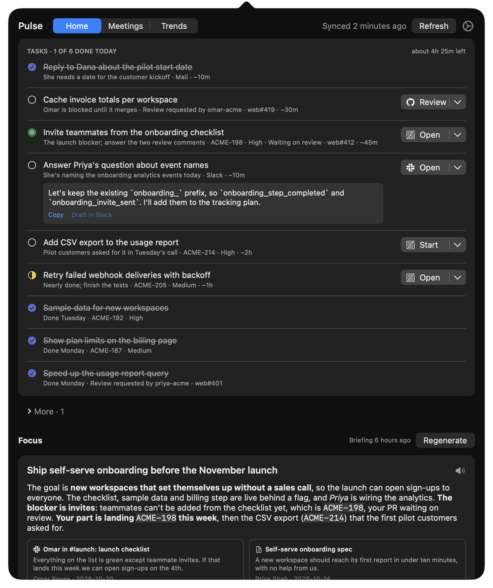
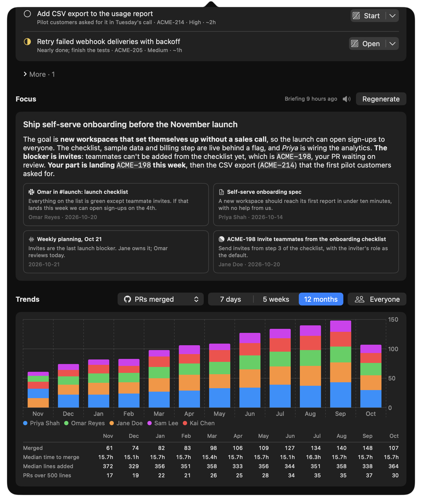

# Pulse

A macOS menu-bar app that tells you what to work on today, what your team is focused on, and how shipping is trending. Pulse pulls together GitHub, Linear, Slack, Mail and the meetings it records for you.

- **Today**: a short checklist planned each morning to fit about 5 hours, covering reviews to unblock, replies you owe, and the tickets that matter most. Linear tickets show their real status, which you can change from the list. **Start** creates a git worktree on the ticket's branch, moves the ticket to In Progress, and opens it in your IDE's agent panel (Zed, Cursor, VS Code) or in a terminal agent (pi, Claude Code, or your own).
- **Focus**: one distilled summary of what the team is pushing on, with source cards and a button that reads it aloud.
- **Meetings**: Pulse notices Google Meet calls, Slack huddles and calendar meetings, records them, transcribes them on your Mac, and saves a summary with the decisions and important points. The briefing reads them.
- **Trends**: PRs merged and Linear tickets closed per person, over 7 days, 5 weeks or 12 months.

<p align="center">
  
  
</p>

Everything runs on your Mac. Pulse has no server and sends no telemetry. Your data goes only to the services you connect and to the AI agent you choose for the briefing and meeting summaries.

## Requirements

- macOS 14 or later
- [GitHub CLI](https://cli.github.com), signed in (`gh auth login`)
- A Linear personal API key
- For the morning briefing: [pi](https://pi.dev) or [Claude Code](https://claude.com/claude-code), with **Linear** and **Slack** MCP servers configured
- Optional: Mail.app with your email account

## Install

[-000000?style=for-the-badge&logo=apple&logoColor=white)](https://github.com/andymitch/pulse/releases/latest/download/Pulse_aarch64.dmg)

Or install in one line:

```sh
curl -fsSL https://raw.githubusercontent.com/andymitch/pulse/main/scripts/install.sh | sh
```

If you use the download instead, open the dmg and drag Pulse to Applications. The app isn't notarized, so the first time, right-click it and choose **Open**, or run `xattr -dr com.apple.quarantine /Applications/Pulse.app`.

After that, Pulse **updates itself**. It checks GitHub for new releases, shows an **Update** button when one is ready, checks the update's signature, and relaunches. To get pre-releases too, turn on **Beta updates** in Settings.

To build it yourself, you only need the Xcode Command Line Tools:

```sh
./build.sh --install
```

## Setup

Click the gear in the popover.

1. **GitHub**: pick your `gh` account and organization. Pulse matches GitHub people to Linear people automatically, first by GitHub profile name, then by login.
2. **Linear**: paste a personal API key (Linear, then Settings, Security & access). It's stored in your Keychain and can be replaced or removed there.
3. **Slack**: leave it on. The briefing agent reads Slack through its own Slack MCP server, finds you from that login, and picks your busiest channels. You can name channels yourself if you prefer.
4. **Mail**: turn it on, and macOS asks once for permission to read Mail.
5. **Meetings**:
   - Record meetings: on by default. Recording starts when another app uses your mic during a Google Meet call, a Slack huddle or a calendar event with attendees, and stops a short while after the mic is released. The menu bar icon turns into a red record button while it records; right-click it and choose **Stop Recording** to skip a meeting. The first time, macOS asks for microphone, screen and system audio recording, and calendar access, and Pulse downloads about 500 MB of speech models. The briefing agent writes each summary from the transcript. Let people know you're recording.
   - Otter: connect it to Slack or have it email its summaries.
   - Loom: links shared in Slack or email are picked up without setup.
6. **Code**: set the repository and the folder for new worktrees, then choose your IDEs and terminal agents. In an agent command, `{prompt}` is replaced with the path of a file holding the ticket prompt.
7. **Briefing**: choose the agent command and the hour it runs. You can also press **Regenerate** at any time.

### MCP servers for the briefing

- **pi**: add the servers to `~/.pi/agent/mcp.json`.
- **Claude Code**: run `claude mcp add` once for Linear and once for Slack.

The briefing only reads: the prompt tells the agent never to post or change anything. It writes a single JSON file, which Pulse checks before using.

## Data

Pulse keeps everything in `~/Library/Application Support/Pulse/`:
- `pulse.db`: the SQLite cache behind Trends
- `settings.json`
- `synthesis.json`: the latest briefing
- `meetings/`: meeting summaries and transcripts, one Markdown file per meeting
- `recordings/`: meeting audio, kept only until it's transcribed
- `mail/`: the latest inbox export

The speech models live in `~/Library/Application Support/FluidAudio/`.

Delete the folder to start fresh. The Linear key lives in the Keychain under `pulse`.

## Development

```sh
swift build
swift run Pulse --self-test
./build.sh --install
```

To try Pulse without connecting anything, run `open build/Pulse.app --args --demo`. It uses a fictional team and a throwaway data folder, and never syncs. The screenshots above are the demo.

### Releasing

Go to Actions → **Release** → Run workflow, and pick one of:
- **major**: the next `vN`
- **hotfix**: `vN.X` off the latest major
- **beta**: `vN-beta.X` of the next major, published as a pre-release

The workflow builds on macOS, signs the update zip with the `PULSE_UPDATE_KEY` secret, uploads `Pulse_aarch64.zip`, its `.sig` and `Pulse_aarch64.dmg` to a draft release, and publishes it with categorized notes once everything is attached. Notes are grouped by the label of the issue each PR closes.

The update key is an Ed25519 key. `swift scripts/sign-update.swift keygen` prints a new private key, and prints its public key to stderr. The private key goes in the repository secret, and the public key is `Updater.publicKey`.

To ship a notarized build, set `DEVELOPER_ID` (a "Developer ID Application" identity) and `NOTARY_PROFILE` (a `notarytool store-credentials` profile) for `./build.sh --release`.

Known limits:
- One repository at a time.
- Apple silicon only.
- Slack, Otter and Loom are read by the briefing agent rather than by Pulse itself.

## License

MIT
